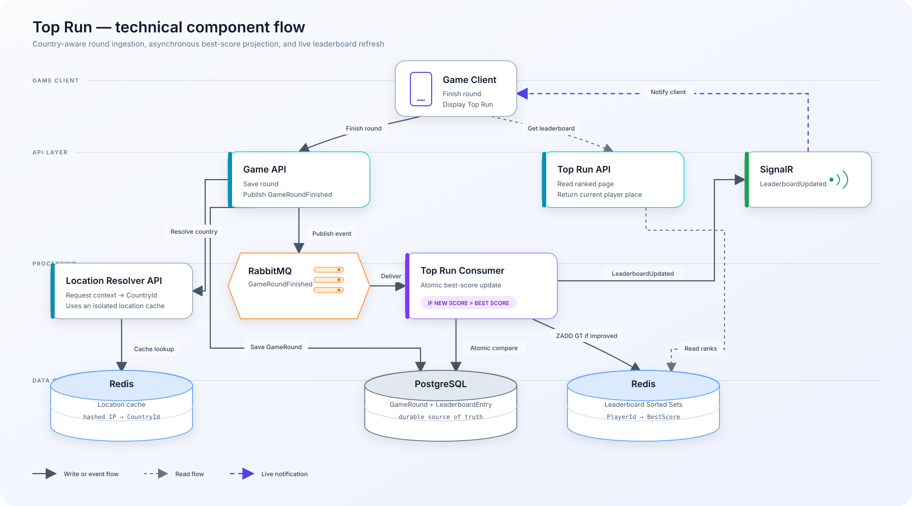
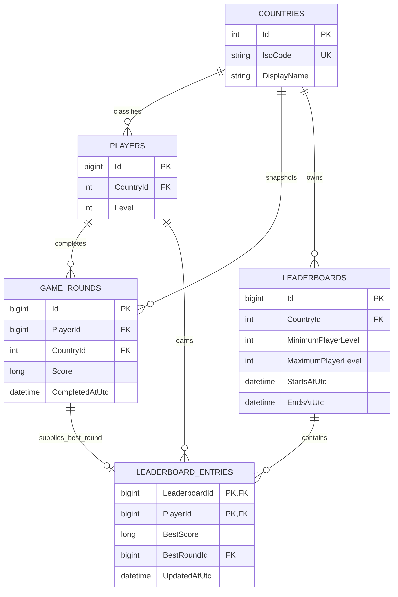
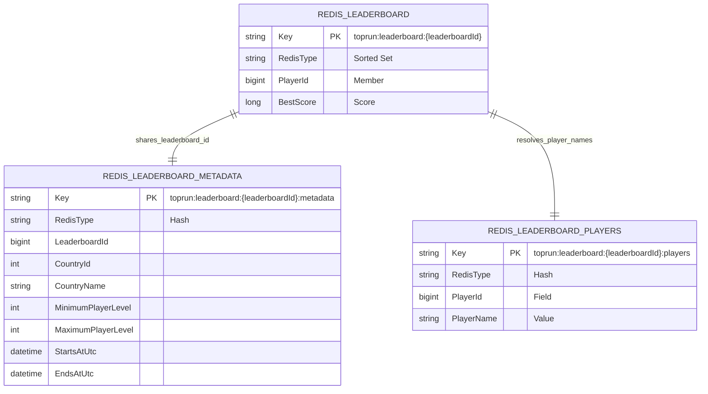

# Top-Run Feature Implementation Guide

## Feature Description

Top-Run is a **weekly** competitive leaderboard feature that will be added to Subway Surfers. It allows players to compare their performance with other players after finishing a round. Each player competes against players within a similar **level range** and from the same **country**, making the competition more relevant and fair. The player's **best score** during the week determines their position on the leaderboard.

From a business perspective, the feature consists of:

- **Round result:** The player's score is recorded when they finish a round.
- **Best score:** Only the player's **best score** during the week is used to determine their position.
- **Player group:** The player is grouped with other players from the same **country** and within the same **level range**.
- **Leaderboard:** The board displays the competing players and their scores.
- **Player position:** The player can see their current rank among the other players on the board.
- **Competition period:** The leaderboard runs **weekly**.
- **Leaderboard tiers:** Players are placed into **Champion** (**Top 1**), **Diamond**, **Gold**, **Silver**, or **Bronze** based on their position.

## Reference Image


*Image source: Uiland — Subway Surfers Top Run leaderboard. [Open the local image](Screenshot_20241105_215802.png).*

## Implementation Overview

This section gives developers the big picture of what to implement.

### Assumptions

- The **Game API** already saves game rounds and calculates scores.
- The **Authenticator App** already authenticates players.
- **PostgreSQL**, **Redis**, and **RabbitMQ** infrastructure already exists.
- The `GameRounds` table already exists.
- The level-to-tier mapping already exists.

### Implementation Steps

1. **Implement the Location Resolver application.**
   - Use [MaxMind](https://www.maxmind.com/en/home) to resolve the player's **country** from the request IP address.
   - Cache the IP-to-country result in Redis.

2. **Update the Game API.**
   - Add `CountryId` to the existing `GameRounds` table.
   - Extract the client IP from the game request and pass it to the Location Resolver when a player finishes a round.
   - Save the score and `CountryId` with the completed round in PostgreSQL.
   - Publish a `GameRoundFinished` event to RabbitMQ through MassTransit.

3. **Add Top Run storage.**
   - Add `Leaderboard` and `LeaderboardEntry` tables in PostgreSQL.
   - Store each live leaderboard in a [Redis leaderboard](https://redis.io/docs/latest/develop/use-cases/leaderboard/) using a Sorted Set.

4. **Implement `TopRunConsumer`.**
   - Consume `GameRoundFinished` events from RabbitMQ through MassTransit.
   - Process events idempotently so duplicate deliveries produce the same result and do not apply the update more than once.
   - Compare the new score with the player's existing **best score** for the current leaderboard.
   - When the new score is higher, update `LeaderboardEntry` in PostgreSQL and update the Redis leaderboard.

5. **Implement the Top Run API.**
   - Read the current player's **country** and current level.
   - Find the active `Leaderboard` row matching:
     - `CountryId`
     - Player level between `MinimumPlayerLevel` and `MaximumPlayerLevel`
     - Current time between `StartsAtUtc` and `EndsAtUtc`
   - Use its `LeaderboardId` to build the Redis leaderboard key.
   - Read the top players in descending score order with `SortedSetRangeByRankWithScoresAsync`.
   - Read and return the leaderboard entries, the player's position, and the player's tier.

6. **Notify connected clients.**
   - After a leaderboard update, send a `LeaderboardUpdated` notification through SignalR WebSocket.
   - The client then requests the latest leaderboard data.

### Technologies

- **.NET Core:** Implements the Location Resolver, Top Run API, and `TopRunConsumer`.
- **RabbitMQ with MassTransit:** Publishes and consumes the `GameRoundFinished` event.
- **PostgreSQL:** Stores completed rounds, leaderboards, and best-score entries.
- **Redis Hashes and Sorted Sets:** Cache resolved countries, store leaderboard metadata, and maintain live rankings.
- **SignalR:** Notifies clients when their leaderboard changes and uses a Redis backplane across application instances.
- **[MaxMind](https://www.maxmind.com/en/home):** Resolves the player's country from the client IP address.

### Communication

- **HTTP:** The Game API passes the client IP to the Location Resolver and calls the Top Run API.
- **MassTransit over RabbitMQ:** The Game API publishes `GameRoundFinished`; `TopRunConsumer` consumes it.
- **SignalR WebSocket:** The Top Run application sends `LeaderboardUpdated` notifications to connected clients.

## System Design Diagram



## Database Diagram



## Redis Leaderboard Model

### Redis Model Diagram



## Why Redis Leaderboard (Sorted Set)

A Redis Sorted Set keeps players ordered by score and updates the ranking automatically when a score changes. It supports fast top-player and player-position queries without sorting the complete leaderboard in the application. See the official [Redis leaderboard documentation](https://redis.io/docs/latest/develop/use-cases/leaderboard/).

The Sorted Set keeps `PlayerId` as its stable member. The companion `toprun:leaderboard:{leaderboardId}:players` Hash maps each `PlayerId` to its `PlayerName`, allowing the API to attach player names to the ranked results.

Read the highest-scoring players in descending order:

```csharp
var topPlayers = await database.SortedSetRangeByRankWithScoresAsync(
    leaderboardKey,
    start: 0,
    stop: limit - 1,
    order: Order.Descending);
```

Read the current player's zero-based rank and convert it to a displayed position:

```csharp
var rank = await database.SortedSetRankAsync(
    leaderboardKey,
    playerId,
    Order.Descending);
```

With StackExchange.Redis, use `SortedSetWhen.GreaterThan` so a lower score cannot replace the player's existing **best score**. This maps to Redis `ZADD GT`:

```csharp
await database.SortedSetAddAsync(
    leaderboardKey,
    playerId,
    bestScore,
    SortedSetWhen.GreaterThan);
```

## API Documentation

Base path: `/api/v1`

All endpoints require the existing bearer authentication. `PlayerId` comes from the authenticated player.

### Resolve Current Player Country

```http
POST /api/v1/players/me/country/resolve
Authorization: Bearer {token}
```

Request: The Game API extracts the original client IP from the game request and passes it to the Location Resolver.

Response: `200 OK`

```json
{
  "countryId": 34,
  "countryCode": "ES",
  "countryName": "Spain"
}
```

### Finish Game Round

```http
POST /api/v1/game-rounds/{roundId}/finish
Authorization: Bearer {token}
Content-Type: application/json
```

Request:

```json
{
  "score": 125400
}
```

Response: `200 OK`

```json
{
  "roundId": 84721,
  "score": 125400,
  "status": "completed"
}
```

### Get Current Leaderboard

```http
GET /api/v1/top-run/current?limit=50
Authorization: Bearer {token}
```

Request:

- `limit`: Number of entries to return, between 1 and 100. The default is 50.

Response: `200 OK`

```json
{
  "leaderboardId": 42,
  "country": {
    "code": "ES",
    "name": "Spain"
  },
  "levelRange": {
    "minimum": 21,
    "maximum": 30
  },
  "startsAtUtc": "2026-09-21T00:00:00Z",
  "endsAtUtc": "2026-09-28T00:00:00Z",
  "entries": [
    {
      "rank": 1,
      "playerId": 1201,
      "displayName": "RunnerOne",
      "score": 245000,
      "tier": "Champion",
      "isCurrentPlayer": false
    },
    {
      "rank": 2,
      "playerId": 1842,
      "displayName": "RunnerTwo",
      "score": 238500,
      "tier": "Diamond",
      "isCurrentPlayer": false
    }
  ],
  "currentPlayer": {
    "rank": 18,
    "playerId": 2275,
    "displayName": "CurrentRunner",
    "score": 125400,
    "tier": "Silver"
  }
}
```

Each player's `tier` is calculated from their leaderboard rank.

## Event Documentation

### `GameRoundFinished`

The Game API publishes this event after successfully saving a completed round. `TopRunConsumer` consumes it to update the player's best score.

Routing key:

```text
game.round.finished
```

Event:

```json
{
  "roundId": 84721,
  "playerId": 2275,
  "countryId": 34,
  "score": 125400,
  "completedAtUtc": "2026-09-25T10:30:00Z"
}
```

Event members:

- `roundId`: Identifies the completed game round.
- `playerId`: Identifies the authenticated player who completed the round.
- `countryId`: Identifies the country resolved and saved when the round was completed.
- `score`: Contains the validated, non-negative round score.
- `completedAtUtc`: Contains the UTC time when the round was completed.

The consumer uses `CountryId` from the event and loads the player's level to select the leaderboard active at `CompletedAtUtc`.

### `LeaderboardUpdated`

`TopRunConsumer` sends this SignalR event after successfully updating the PostgreSQL and Redis leaderboards.

Hub route:

```text
/hubs/top-run
```

Event name:

```text
LeaderboardUpdated
```

Payload:

```json
{
  "leaderboardId": 42
}
```

Event member:

- `leaderboardId`: Identifies the leaderboard that changed.

After receiving the event, the client calls the current-leaderboard API to retrieve the latest entries, position, and tier.
